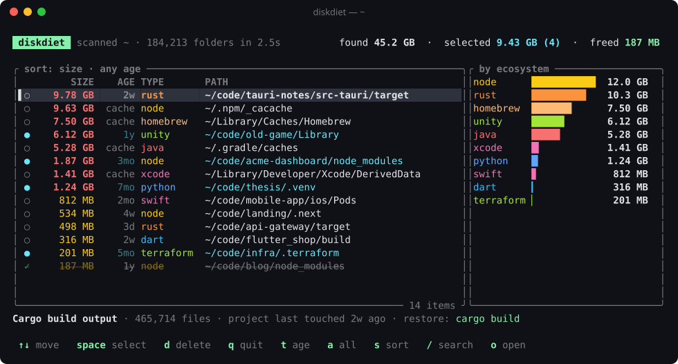

<div align="center">

# 🥗 diskdiet

**Your disk is full of `node_modules`. Put it on a diet.**

diskdiet finds the gigabytes your dev tools leave behind (dependency folders, build output, virtualenvs, Xcode DerivedData, package-manager caches) and lets you delete them safely, in seconds.

[](https://github.com/Baimmmss/diskdiet/actions/workflows/ci.yml)
[](https://crates.io/crates/diskdiet)
[](LICENSE)




</div>

## Why

Every project you've ever cloned left something behind: a `node_modules` here, a 10 GB Rust `target/` there, a `.venv` from a tutorial you did once. Add the caches that npm, Homebrew, Gradle, pip, Cargo and Xcode keep, and a typical developer laptop carries **tens of gigabytes** of stuff that can be rebuilt with a single command.

diskdiet finds all of it in one pass and shows you what's worth deleting first.

- ⚡ **Fast.** A parallel scanner walks a whole home folder in seconds. Results stream in while the scan runs.
- 🧠 **Knows 20+ ecosystems.** Node, Rust, Python, Java/Gradle/Maven, Swift/CocoaPods, Xcode, Flutter, Go, .NET, Unity, Godot, Terraform, Elixir, Haskell, Zig, PHP and more.
- 🌍 **Finds global caches too.** npm, Yarn, pnpm, Bun, pip, uv, Poetry, Cargo, Go, Gradle, Maven, NuGet, Homebrew, CocoaPods, Playwright, Electron, Xcode DerivedData and more.
- 🕰️ **Knows what's stale.** Each folder shows when its *project* was last edited, so you can clear everything you haven't touched in 3 months with two keystrokes.
- 🛡️ **Careful by design.** See [Safety](#safety).
- 🪶 **Tiny.** A ~1.4 MB single binary (about 0.7 MB to download) that uses about 5 MB of memory and no CPU while you browse.
- 🤖 **Scriptable.** `--list`, `--json` and `--delete --yes` for cron jobs and CI runners.

## Install

With [Rust](https://rustup.rs) installed (any OS, including Windows):

```bash
cargo install --git https://github.com/Baimmmss/diskdiet --locked diskdiet
```

Or use the install script (macOS, Linux). It downloads a prebuilt binary from the latest [release](https://github.com/Baimmmss/diskdiet/releases) and falls back to building with cargo when there isn't one for your machine:

```bash
curl -fsSL https://raw.githubusercontent.com/Baimmmss/diskdiet/master/DiskDiet/install.sh | sh
```

From a clone:

```bash
git clone https://github.com/Baimmmss/diskdiet && cd diskdiet/DiskDiet
cargo install --path . --locked
```

## Use it

```bash
diskdiet                 # scan your home folder + global caches, pick what to delete
diskdiet ~/code          # scan just one folder
```

| Key | Action |
| --- | --- |
| `↑` `↓` / `j` `k` | move |
| `space` | select / unselect |
| `a` | select everything visible |
| `t` | age filter: any → untouched 30 days → 90 days → 1 year |
| `s` | sort by size / age / path |
| `/` | search by path or ecosystem |
| `o` | open the project folder in Finder / Explorer |
| `d` | delete selected (asks first) |
| `q` | quit |

Deletion runs in the background, so you can keep browsing while it works.

### Without the UI

```bash
diskdiet ~/code --older-than 3m          # projects untouched for 3+ months
diskdiet --caches-only --list            # how big are my package-manager caches?
diskdiet ~/code --only node,python --min-size 100MB --list
diskdiet --json | jq '.total_bytes'      # machine-readable output

# clean old node_modules in CI runners or a weekly cron job
diskdiet ~/code --only node --older-than 30d --delete --yes
```

Run `diskdiet --help` for every flag, and `diskdiet --ecosystems` for the full list.

## What it finds

| Ecosystem | Project folders | Only when next to |
| --- | --- | --- |
| node | `node_modules`, `.next`, `.nuxt`, `.svelte-kit`, `.turbo`, `.parcel-cache`, `.angular`, `.expo`, … | `package.json` |
| rust | `target` | `Cargo.toml` |
| java | `target` / `build`, `.gradle` | `pom.xml` / `build.gradle(.kts)` |
| python | `.venv`, `venv`, `env`, `.tox`, `__pycache__`, `.mypy_cache`, `.pytest_cache`, `.ruff_cache` | `pyvenv.cfg` inside (for venvs) |
| swift | `.build`, `Pods` | `Package.swift` / `Podfile` |
| dart | `.dart_tool`, `build` | `pubspec.yaml` |
| .net | `bin`, `obj` | `*.csproj` / `*.fsproj` |
| unity | `Library`, `Temp`, `Logs` | `ProjectSettings/ProjectVersion.txt` |
| godot | `.godot` | `project.godot` |
| terraform | `.terraform` | `*.tf` |
| elixir | `_build`, `deps` | `mix.exs` |
| haskell | `.stack-work`, `dist-newstyle` | `stack.yaml` / `*.cabal` |
| zig, c/c++, elm, php, android | `zig-cache`, `cmake-build-*`, `elm-stuff`, `vendor`, `.cxx` | `build.zig`, `CMakeLists.txt`, `elm.json`, `composer.json`, Gradle files |

Every result also shows **what it is** and **how to get it back** (e.g. `restore: cargo build`).

## Safety

Deleting things is scary, so diskdiet is deliberately conservative:

- **A folder name alone is never enough.** `target/` only counts next to a `Cargo.toml` or `pom.xml`. A `build/` folder without a Gradle or Flutter project beside it is ignored. So is a `bin/` without a `.csproj`.
- **Never follows symlinks**, during the scan or the delete, and re-checks that each path is still a real directory right before removing it.
- **Skips places where artifacts aren't yours to delete:** hidden app folders in your home (`~/.config`, `~/.vscode`, …), `.git` internals, editor extension folders (`~/.vscode/extensions`, Cursor, Windsurf, …), SDK checkouts such as Flutter, toolchain installs (`.rustup`, `.nvm`, `.pyenv`, conda), and app bundles.
- **Always asks before deleting.** In scripts, `--delete` refuses to run without `--yes`.
- **Accurate numbers.** Sizes are real disk usage (allocated blocks), and hard-linked files from pnpm or uv are only counted once, so "freed 12 GB" means 12 GB.
- **No network, no telemetry.** diskdiet only reads your filesystem.

> Deleted folders skip the trash. Everything diskdiet lists can be rebuilt, but double-check before you delete anything you aren't sure about.

## How it compares

[npkill](https://github.com/voidcosmos/npkill) is great if you only care about `node_modules`. diskdiet covers 20+ ecosystems **and** the machine-wide caches in the same pass, tells you how stale each project is, and works the same on macOS, Linux and Windows as a single binary.

## Contributing

Know a folder that should be on the list? Adding one is usually a 6-line change in [`src/rules.rs`](src/rules.rs) or [`src/caches.rs`](src/caches.rs). See [CONTRIBUTING.md](CONTRIBUTING.md).

If diskdiet freed up space for you, a ⭐ helps other people find it.

## License

[MIT](LICENSE)
