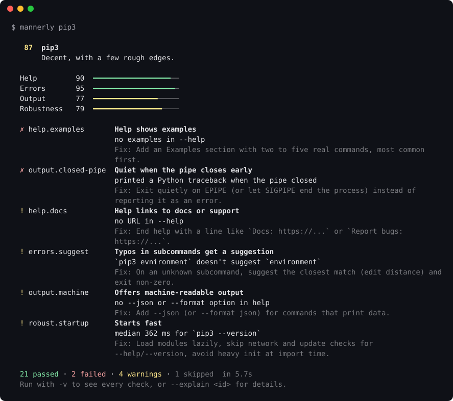

<div align="center">

# 🎩 mannerly

**Lighthouse for command-line tools.**

One command checks how any CLI behaves for people, scripts and AI agents,<br>
scores it from 0 to 100, and tells you exactly how to fix what's wrong.

[](https://github.com/Baimmmss/mannerly/actions/workflows/ci.yml)
[](https://crates.io/crates/mannerly)
[](LICENSE)
[](https://github.com/Baimmmss/mannerly)



</div>

```bash
cargo install mannerly
mannerly <your-tool>
```

## Why

Your CLI isn't only used by people at a terminal anymore. Scripts pipe it, CI runs it with no terminal at all, and coding agents call it hundreds of times a day, reading every byte it prints. The small things decide whether that works:

- `--help` that fails, or goes to stderr where `| less` can't see it
- exit code **0** on a typo, so CI and agents think everything worked
- `^[[31m` color junk in pipes, logs and agent context
- a Python traceback when someone runs `tool | head -1`
- a prompt that waits forever when there's no one to answer it
- Ctrl-C that does nothing

The rules for all of this are written down ([clig.dev](https://clig.dev), [no-color.org](https://no-color.org), POSIX conventions), but they are rarely checked. **mannerly checks them from the outside, for a CLI in any language.** No config, no code changes, a few seconds for most tools.

## How do well-known tools score?

Run on macOS 26 with the tools' default versions. `ls`, `cat` and `grep` are the BSD versions, which have no `--help` or `--version`. Startup times vary a little from run to run, so a tool near the 150 ms line can move a few points.

| Score | Command | Help | Errors | Output | Robustness | Failed checks |
|---:|---|---:|---:|---:|---:|---|
| 100 | `jq` | 100 | 100 | 100 | 100 | – |
| 99 | `cargo` | 99 | 98 | 98 | 100 | – |
| 96 | `node` | 90 | 98 | 97 | 100 | `help.examples` |
| 96 | `curl` | 89 | 100 | 100 | 100 | `help.examples` |
| 96 | `brew` | 100 | 98 | 98 | 79 | – |
| 95 | `uv` | 90 | 95 | 98 | 100 | `help.examples` |
| 95 | `make` | 89 | 97 | 97 | 100 | `help.examples` |
| 95 | `git` | 90 | 98 | 97 | 100 | `help.examples` |
| 95 | `gh` | 97 | 91 | 92 | 100 | – |
| 94 | `python3` | 82 | 100 | 97 | 100 | `help.examples`, `help.width` |
| 93 | `rustc` | 82 | 98 | 98 | 100 | `help.examples`, `help.width` |
| 92 | `tar` | 79 | 98 | 100 | 100 | `help.usage`, `help.examples` |
| 86 | `grep` | 35 | 100 | 100 | 100 | `help.flag` |
| 84 | `pip3` | 90 | 95 | 77 | 57 | `help.examples`, `output.closed-pipe`, `robust.startup` |
| 76 | `ls` | 6 | 98 | 100 | 100 | `help.flag`, `help.version` |
| 74 | `npm` | 45 | 74 | 100 | 79 | `help.flag`, `errors.stderr` |
| 73 | `cat` | 6 | 92 | 100 | 92 | `help.flag`, `help.version` |
| 71 | `go` | 5 | 92 | 100 | 100 | `help.flag`, `help.subcommand`, `help.version` |

Regenerate it yourself: `sh scripts/leaderboard.sh git cargo gh jq npm …`

## What it checks

mannerly runs your command about 20 times, in three ways:

- **In a pipe**, with stdin from `/dev/null`, the way scripts, CI and agents run it.
- **In a real terminal** (a pseudo-terminal that answers color and cursor queries like a real one), with and without `NO_COLOR=1` and `TERM=dumb`, and presses Ctrl-C.
- **With its output pipe already closed**, like `tool | head -0`.

Each run is checked against 28 rules. A pass earns the check's full weight, a warning half, a failure nothing. Checks that don't apply (no subcommands, no color) are skipped and don't count.

**Help**

| Check | What a well-behaved tool does | Weight |
|---|---|---:|
| `help.flag` | --help prints help and exits 0 | 10 |
| `help.stdout` | Help goes to stdout | 5 |
| `help.short` | -h also shows help | 2 |
| `help.usage` | Help starts with a usage line | 3 |
| `help.examples` | Help shows examples | 3 |
| `help.width` | Help fits in 100 columns when piped | 2 |
| `help.subcommand` | Subcommands have their own --help | 3 |
| `help.docs` | Help links to docs or support | 1 |
| `help.version` | --version prints a version number | 5 |

**Errors**

| Check | What a well-behaved tool does | Weight |
|---|---|---:|
| `errors.exit-code` | Unknown flags fail with a non-zero exit | 10 |
| `errors.stderr` | Errors go to stderr | 5 |
| `errors.message` | Errors say what went wrong | 4 |
| `errors.concise` | Errors are short | 2 |
| `errors.usage-code` | Usage errors exit with code 2 | 1 |
| `errors.suggest` | Typos in subcommands get a suggestion | 3 |
| `errors.no-traceback` | No stack traces or crashes | 8 |

**Output**

| Check | What a well-behaved tool does | Weight |
|---|---|---:|
| `output.pipe-color` | No escape codes when piped | 8 |
| `output.no-color` | Respects NO_COLOR | 5 |
| `output.term-dumb` | Plain text when TERM=dumb | 2 |
| `output.closed-pipe` | Quiet when the pipe closes early | 5 |
| `output.stderr-quiet` | Nothing on stderr for --help and --version | 2 |
| `output.newline` | Output ends with a newline | 1 |
| `output.machine` | Offers machine-readable output | 1 |

**Robustness**

| Check | What a well-behaved tool does | Weight |
|---|---|---:|
| `robust.startup` | Starts fast | 6 |
| `robust.no-hang` | Doesn't hang without a terminal | 3 |
| `robust.ctrl-c` | Ctrl-C works | 5 |
| `robust.not-silent` | Never waits silently | 2 |
| `robust.no-litter` | --help and --version write no files | 3 |

Run `mannerly --explain <id>` to see why a check matters and how to fix it, or `mannerly --list-checks` for the full list.

## Usage

```bash
mannerly gh                              # check an installed tool
mannerly ./target/debug/mytool           # check your own build
mannerly cargo clippy                    # check a subcommand
mannerly --json -- npx mytool            # use -- when the command has flags
mannerly -v mytool                       # list every check, passes too
mannerly --explain output.closed-pipe    # why it matters, how to fix it
```

| Flag | |
|---|---|
| `--json` | Machine-readable report, with `why` and `fix` for every check |
| `--markdown` | Report for PR comments and CI job summaries |
| `--badge FILE` | Also write an SVG score badge |
| `--min-score N` | Exit 1 if the score is below N |
| `-q`, `--quiet` | Print only the score |
| `--skip ID,…` | Skip checks that don't fit your tool |
| `--no-bare` | Never run the command with no arguments |
| `--timeout SECS` | Time limit per run (default 10, raised automatically for slow tools) |

Exit codes: `0` done, `1` below `--min-score` or the command couldn't run, `2` bad mannerly arguments.

## In CI

```yaml
- uses: Baimmmss/mannerly@v0.1.0
  with:
    command: ./target/release/mytool
    min-score: 90
```

The action writes the report to the job summary and fails the step below `min-score`. Without the action:

```bash
mannerly --min-score 90 --markdown ./target/release/mytool >> "$GITHUB_STEP_SUMMARY"
```

### Badge

```bash
mannerly --badge assets/manners.svg ./target/release/mytool
```

```markdown

```

## For coding agents

Agents write a lot of CLIs now, and they rarely check how those CLIs behave. mannerly ships an [agent skill](skills/mannerly/SKILL.md) that has the agent run `mannerly --json` on what it built and fix the findings, with recipes for clap, cobra, argparse, click, commander, yargs and shell scripts.

```bash
npx skills add Baimmmss/mannerly          # Claude Code, Codex, Cursor, OpenCode, …
```

Or as a Claude Code plugin: `/plugin marketplace add Baimmmss/mannerly`.

The `--json` output is built for agents: every check comes with what was observed, why it matters and how to fix it.

## Install

```bash
cargo install mannerly
```

Or a prebuilt binary (macOS, Linux):

```bash
curl -fsSL https://raw.githubusercontent.com/Baimmmss/mannerly/main/install.sh | sh
```

macOS and Linux are fully supported. On Windows the terminal and closed-pipe checks are skipped.

## Safety

mannerly runs the command you give it: with `--help`, `-h`, `--version`, an unknown flag, a misspelled subcommand, a subcommand's `--help`, and **with no arguments**. Each run happens in an empty temporary folder with stdin from `/dev/null`, and is stopped (with its whole process group) if it runs too long.

Don't point it at a command that does something destructive when run with no arguments, or pass `--no-bare` to skip those runs. A few well-known commands (`reboot`, `shutdown`, `kill`, `sudo`, editors, pagers, …) are never run bare.

## FAQ

**Isn't this opinionated?** Yes, the way a linter is. Every check follows a widely used convention, and the weights put the things that break scripts and agents (exit codes, color in pipes, crashes) far above style (a docs link). If a check is wrong for your tool, `--skip` it.

**My tool fails `robust.no-hang`, but it's a server.** That's a warning, not a failure, for exactly that reason. Use `--skip robust.no-hang` or `--no-bare`.

**My REPL failed the Ctrl-C check.** It shouldn't: mannerly presses Ctrl-C, then Ctrl-C again, then Ctrl-D, and REPL-style handling passes. If it still fails, please [open an issue](https://github.com/Baimmmss/mannerly/issues/new?template=false-positive.yml); `MANNERLY_DUMP=1` shows exactly what each run printed.

**Does it send anything anywhere?** No. It runs locally, makes no network requests and collects nothing.

## Contributing

Ideas for new checks and reports of wrong results are very welcome. See [CONTRIBUTING.md](CONTRIBUTING.md).

## License

[MIT](LICENSE)
